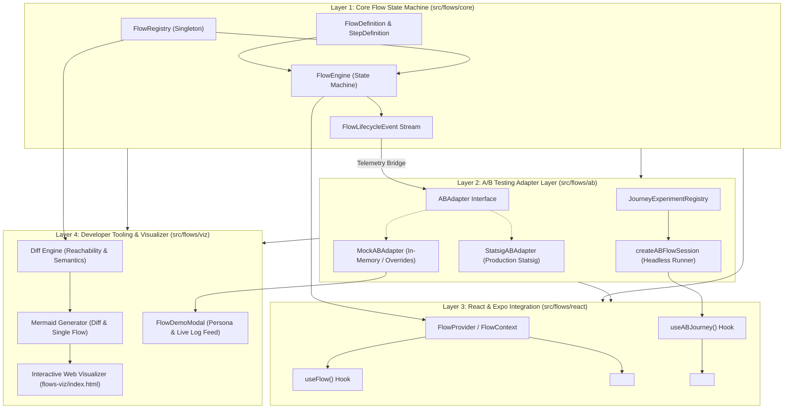
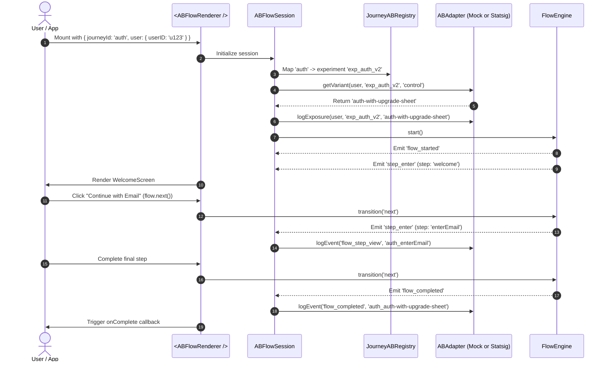
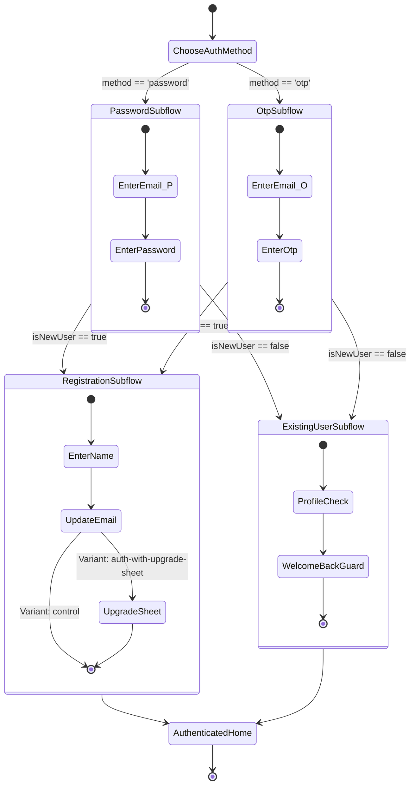

# Flow Orchestration & A/B Experimentation: Architecture Guide

This document describes the high-level architecture, design philosophy, and data pipelines of the **Flow Orchestration Engine** and its **A/B Experimentation Adapter Layer**.

---

## 1. Core Philosophy

When building complex mobile user experiences (authentication funnels, multi-step onboarding, checkout flows, sticker creation workflows), teams frequently encounter three pain points:

1. **Tight Coupling to Navigation**: Hardcoding screens to call `router.push('/next-screen')` scatters business logic across UI components and makes restructuring flows painful.
2. **Vendor Lock-in for A/B Testing**: Directly importing analytics or experimentation SDKs (like Statsig, LaunchDarkly, or Optimizely) into individual screen components introduces boilerplate, complicates testing, and creates vendor lock-in.
3. **Cognitive Overload**: Developers cannot easily visualize how an experiment alters the step sequence, which screens are bypassed, or where decision forks diverge.

### Architectural Principles

- **Pure State Machine Separation**: Core flow transition logic is 100% agnostic of React, Expo, and external A/B vendors.
- **Pluggable Adapter Pattern**: A/B experimentation is isolated behind a lightweight contract (`ABAdapter`). Swapping an in-memory mock for production Statsig requires changing a single provider line.
- **Hierarchical Subflows**: Complex journeys are composed of small, testable, and reusable subflows that can be independently developed and tested.
- **Decoupled Telemetry Pipeline**: The state machine emits generic lifecycle events (`flow_started`, `step_enter`, `flow_completed`, `flow_cancelled`). The adapter translates these into vendor exposures and metric logs.
- **Headless Testability**: 100% of flow paths, branching decisions, and experiment assignments can be tested in Node without mounting React components or mocking the DOM.

---

## 2. Four-Layer System Architecture



---

## 3. Layer Breakdown

### Layer 1: Core Flow State Machine (`src/flows/core/`)

The core engine contains pure TypeScript classes and types:
- **`FlowEngine`**: Manages the step stack, active step, contextual state, navigation history, and subflow execution frames.
- **`defineFlow`**: Strongly typed factory function to declare a flow's steps, transitions, initial context, and completion handlers.
- **Step Types**:
  - `screen`: User-facing UI screen. Advances via `next`.
  - `action`: Headless step for async computations, validation guards, or decision routing without rendering UI.
  - `subflow`: Embeds another complete flow definition as a step. Subflow completion triggers `onComplete` in the parent.
- **`FlowRegistry`**: Central registry of all reusable flows and multi-variant **Journeys**.

### Layer 2: A/B Testing Adapter Layer (`src/flows/ab/`)

The A/B layer bridges business experimentation and the flow engine:
- **`ABAdapter` Interface**: Defines three methods:
  ```typescript
  interface ABAdapter {
    getVariant(user: ExperimentUser, experimentName: string, fallbackVariant: string): Promise<string> | string;
    logExposure(user: ExperimentUser, experimentName: string, variant: string, metadata?: Record<string, any>): void;
    logEvent(user: ExperimentUser, eventName: string, value?: string | number, metadata?: Record<string, any>): void;
  }
  ```
- **`MockABAdapter`**: In-memory adapter with zero external dependencies. Supports static variant overrides, targeting rules, user-specific overrides, and inspection of recorded exposures/events. Ideal for unit tests, local development, and in-app debugging.
- **`StatsigABAdapter`**: Production adapter wrapping the Statsig SDK (`@statsig/js-client` or `@statsig/react-native-bindings`).
- **`JourneyExperimentRegistry`**: Maps human-readable flow journey IDs (`auth`, `sticker-workflow`) to remote experiment keys (`exp_auth_v2`, `exp_sticker_editor`) and variant keys.
- **`createABFlowSession`**: Headless runner that initializes a flow for a given user, resolves the experiment variant, automatically logs exposure upon entry, and maps lifecycle events to metric events.

### Layer 3: React & Expo Integration (`src/flows/react/` & `src/flows/ab/react/`)

Provides declarative React bindings:
- **`<FlowRenderer />`**: Renders the current step's component, provides the flow context, and handles completion/cancellation screens.
- **`useFlow<TContext>()`**: Hook consumed by screens inside a flow to trigger transitions (`next(payload)`, `back()`, `goTo(stepId)`, `complete()`, `cancel()`) and update shared context (`updateContext(partial)`).
- **`useABJourney(options)`**: Evaluates the user's experiment variant using the active `ABAdapter` and returns a configured flow instance.
- **`<ABFlowRenderer />`**: High-level component that automatically resolves the user's A/B variant, logs exposure, and renders the resulting flow.

### Layer 4: Developer Tooling & Visualizer (`src/flows/viz/`)

Tools to eliminate cognitive load when managing variants:
- **Diff Engine (`diff.ts`)**: Analyzes two flow graphs (Control vs Treatment Variant) using reachability algorithms. Identifies:
  - **Added Steps** (green): Steps present in the variant that do not exist in control.
  - **Altered Paths** (amber): Steps present in both flows whose outgoing transition destination changed.
  - **Bypassed Steps** (red dashed): Steps present in control that are unreachable or skipped in the variant.
  - **Impact Narrative**: Auto-generated business summary (e.g., *“Bypasses 2 steps: 'Filter Effects'. Fast-Track.”*).
- **Mermaid Exporters (`mermaid.ts`)**: Generates Mermaid flowchart syntax for single flows or visual diffs with color-coded classes.
- **HTML Visualizer Workbench (`flows-viz/index.html`)**: Standalone browser application featuring a Variant Matrix, Split View (Control vs Variant side-by-side), App Presets, and an Impact Inspector.
- **In-App Demo Modal (`FlowDemoModal.tsx`)**: In-app debug bottom sheet with persona switcher, variant overrides, and live telemetry log stream.

---

## 4. Telemetry & Experiment Lifecycle Pipeline

The flow engine emits pure lifecycle events; the A/B adapter translates them into analytics events without the state machine ever importing a tracking library.



---

## 5. Subflow Hierarchy & Context Isolation

Subflows allow breaking large journeys into modular state machines:



### Context Isolation Model:
1. When a parent step defines `type: 'subflow'`, it can specify `mapContextToSubflow: (parentContext) => subflowContext`.
2. The subflow operates on its own context without polluting the parent state machine.
3. Upon subflow exit, `onComplete: (parentContext, subflowResult) => nextStep` receives the child's final result, merges data back into parent state, and returns the next step in the parent flow.

---

## 6. Directory Structure Overview

When integrated into an application, the architecture follows this directory convention:

```text
src/
├── flows/                      # Reusable flow framework
│   ├── core/                   # Layer 1: Pure state machine
│   │   ├── engine.ts           # FlowEngine implementation
│   │   ├── registry.ts         # FlowRegistry singleton
│   │   ├── types.ts            # Flow, Step, Context, Event definitions
│   │   └── index.ts
│   ├── ab/                     # Layer 2: A/B adapter layer
│   │   ├── types.ts            # ABAdapter, ExperimentUser, Event interfaces
│   │   ├── mock-adapter.ts     # In-memory testing adapter
│   │   ├── statsig-adapter.ts  # Production Statsig adapter
│   │   ├── registry.ts         # Journey <-> Experiment registry
│   │   ├── session.ts          # Headless test session runner
│   │   ├── provider.ts         # Active adapter holder
│   │   ├── react/              # useABJourney & ABFlowRenderer
│   │   └── index.ts
│   ├── react/                  # Layer 3: React & Expo integration
│   │   ├── FlowContext.tsx     # FlowProvider & context
│   │   ├── FlowRenderer.tsx    # Declarative step renderer
│   │   ├── useFlow.ts          # Step hook
│   │   └── index.ts
│   ├── viz/                    # Layer 4: Visualization & Diffing
│   │   ├── diff.ts             # Reachability diff engine
│   │   ├── mermaid.ts          # Mermaid diagram compilers
│   │   ├── html-generator.ts   # Standalone HTML workbench
│   │   └── index.ts
│   └── index.ts                # Main public exports
│
├── journeys/                   # Application-specific flow definitions
│   ├── auth/                   # Authentication Journey
│   │   ├── control.ts          # Baseline control flow
│   │   ├── variants/           # Treatment variants
│   │   ├── subflows/           # Reusable subflows
│   │   ├── screens/            # UI components
│   │   └── types.ts            # AuthContext definition
│   └── sticker-workflow/       # Sticker editor journey
│
└── scripts/
    └── flows-viz.ts            # CLI compiler for docs and HTML workbench
```
