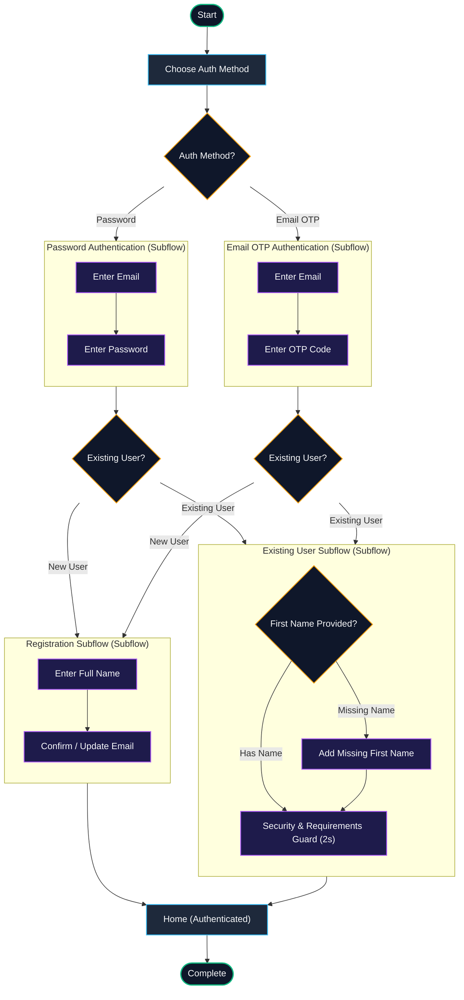
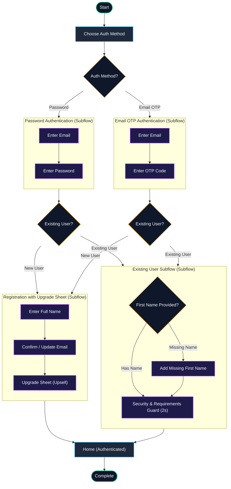
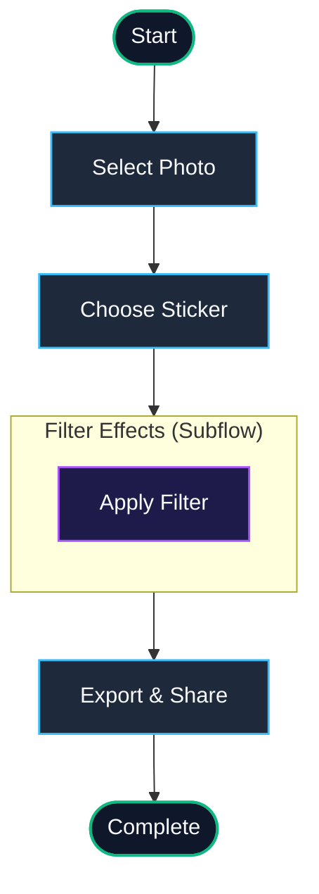
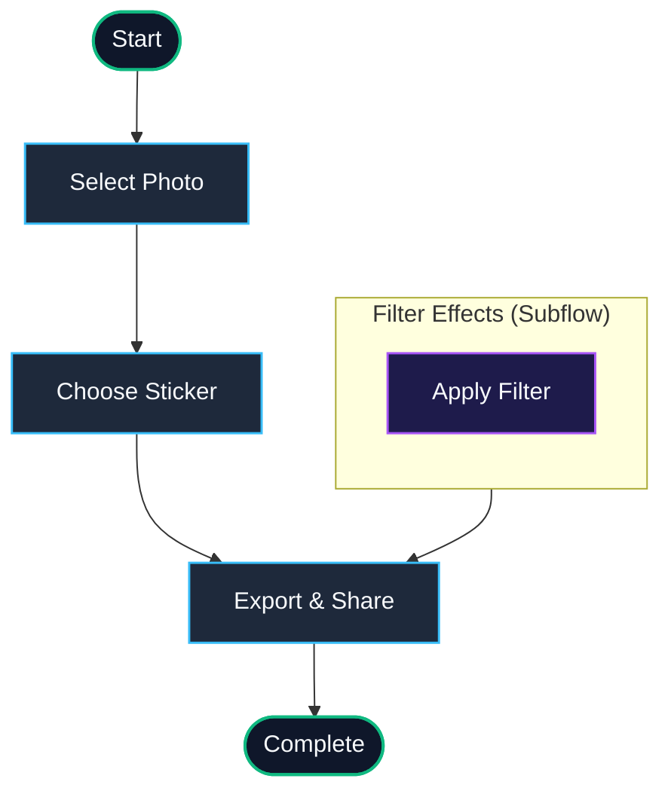

# Flow Orchestration & State Machine Documentation

This file is automatically generated by `npm run flows:viz`. It documents all registered journeys, their variants, subflows, and state machine transitions.

## Table of Contents
- [Classic Authentication Journey (`auth`)](#journey-auth)
- [Sticker Creation Journey (`sticker-workflow`)](#journey-sticker-workflow)

---
## Journey: Classic Authentication Journey
**ID**: `auth`
**Description**: Multi-channel authentication orchestrator featuring Password vs Email-OTP subflows, registration, profile completion, and automated security guard validation.

### Variant: `control` *(Control / Default)*

| Step ID | Title | Type | Next Target |
| :--- | :--- | :--- | :--- |
| `welcome` | Choose Auth Method | `screen` | **Email OTP** &rarr; `otpAuth` \| **Password** &rarr; `passwordAuth` |
| `passwordAuth` | Password Authentication | `subflow` | **Existing User** &rarr; `existingUser` \| **New User** &rarr; `registration` |
| `otpAuth` | Email OTP Authentication | `subflow` | **Existing User** &rarr; `existingUser` \| **New User** &rarr; `registration` |
| `registration` | Registration Subflow | `subflow` | `authenticatedHome` |
| `existingUser` | Existing User Subflow | `subflow` | `authenticatedHome` |
| `authenticatedHome` | Home (Authenticated) | `screen` | *[Terminal]* |

### Variant: `auth-with-upgrade-sheet` 

| Step ID | Title | Type | Next Target |
| :--- | :--- | :--- | :--- |
| `welcome` | Choose Auth Method | `screen` | **Email OTP** &rarr; `otpAuth` \| **Password** &rarr; `passwordAuth` |
| `passwordAuth` | Password Authentication | `subflow` | **Existing User** &rarr; `existingUser` \| **New User** &rarr; `registration` |
| `otpAuth` | Email OTP Authentication | `subflow` | **Existing User** &rarr; `existingUser` \| **New User** &rarr; `registration` |
| `registration` | Registration with Upgrade Sheet | `subflow` | `authenticatedHome` |
| `existingUser` | Existing User Subflow | `subflow` | `authenticatedHome` |
| `authenticatedHome` | Home (Authenticated) | `screen` | *[Terminal]* |

---
## Journey: Sticker Creation Journey
**ID**: `sticker-workflow`
**Description**: Full interactive flow for picking a photo, applying a sticker, tuning effects via subflow, and exporting.

### Variant: `control` *(Control / Default)*

| Step ID | Title | Type | Next Target |
| :--- | :--- | :--- | :--- |
| `selectPhoto` | Select Photo | `screen` | `chooseSticker` |
| `chooseSticker` | Choose Sticker | `screen` | `effects` |
| `effects` | Filter Effects | `subflow` | `exportReview` |
| `exportReview` | Export & Share | `screen` | *[Terminal]* |

### Variant: `quick-smash` 

| Step ID | Title | Type | Next Target |
| :--- | :--- | :--- | :--- |
| `selectPhoto` | Select Photo | `screen` | `chooseSticker` |
| `chooseSticker` | Choose Sticker | `screen` | `exportReview` |
| `effects` | Filter Effects | `subflow` | `exportReview` |
| `exportReview` | Export & Share | `screen` | *[Terminal]* |

---